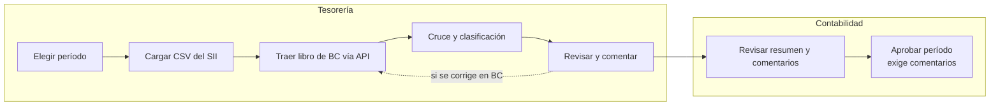

# PRD · Conciliador RCV SII vs Business Central

**Fecha:** 2026-10-15 · **Product Owner:** Miguel Cortés · **Versión:** borrador v0.2

## Contexto y problema

Tesorería concilia hoy a mano el Registro de Compras del SII contra el libro de compras de Microsoft Dynamics 365 Business Central, y el proceso toma 2 días cada período.

El trabajo es repetitivo: descargar el archivo del portal del SII, extraer el libro de Business Central, cruzar documento por documento y anotar las diferencias para que Contabilidad las revise. Una diferencia no detectada puede terminar en crédito fiscal mal declarado en el F29 o en facturas de proveedores sin contabilizar.

## Objetivo

Reducir la conciliación mensual de compras de 2 días a 2 horas o menos, dejando cada documento con diferencia clasificado y comentado antes de que Contabilidad cierre el período.

La app automatiza el cruce entre el SII y Business Central. El tiempo de las personas se concentra solo en investigar y explicar las excepciones.

## Usuarios y roles

| Rol | Área | Qué hace en la app |
| --- | --- | --- |
| Analista de conciliación | Tesorería | Carga el archivo del SII, ejecuta la conciliación, revisa diferencias y las comenta |
| Aprobador | Contabilidad | Revisa el resumen y los comentarios, y aprueba el período en la app |
| Administrador | TI | Configura la conexión con la API de Business Central y los usuarios (supuesto) |

## Alcance del MVP

El MVP concilia facturas afectas y exentas de una empresa, período a período, y deja las diferencias explicadas.

1. Una empresa (un RUT) y un ambiente de Business Central.
2. Carga manual del CSV del Registro de Compras que el usuario descarga del portal del SII.
3. Extracción del libro de compras de Business Central vía API para el mismo período.
4. Documentos tipo 33 (factura electrónica) y 34 (factura exenta electrónica).
5. Solo documentos en estado "Registro" del RCV.
6. Cruce por RUT emisor + tipo de documento + folio, validando todos los campos.
7. Sugerencia de calce aproximado cuando no hay calce exacto, que el usuario confirma o descarta.
8. Clasificación de cada documento en una categoría y resumen por categoría.
9. Comentarios por documento.
10. Historial de conciliaciones por período y aprobación del período por Contabilidad, que exige comentario en toda diferencia.

## Fuera de alcance

- Descarga automática del RCV desde el SII con clave tributaria o certificado digital.
- Otros documentos: facturas de compra (46), notas de débito (56), notas de crédito (61), DIN (914), boletas y liquidaciones-factura.
- Documentos en estado Pendiente, Reclamado o No incluir.
- Registro de Ventas.
- Escribir en Business Central (asientos de ajuste, correcciones) o en el SII (aceptar o reclamar documentos).
- Asignar diferencias a responsables, seguimiento de tareas y notificaciones.
- Exportar el detalle a Excel y pista de auditoría completa (ver decisión P6).
- Varias empresas o varios RUT.
- Preparar o proponer el F29.

## Flujo y requisitos funcionales

Tesorería ejecuta el ciclo completo en la app; Contabilidad solo interviene al final para revisar y aprobar.

El cruce y la clasificación son automáticos. Si Tesorería corrige algo en Business Central, vuelve a traer el libro y a cruzar antes de pasar a Contabilidad.

| ID | Requisito | Criterio de aceptación |
| --- | --- | --- |
| RF-01 | Seleccionar el período tributario (mes y año) | No se puede cargar ni conciliar sin un período seleccionado |
| RF-02 | Cargar el CSV del Registro de Compras del SII | Se rechaza el archivo si el RUT o el período no coinciden con los seleccionados, con un mensaje que indique cuál |
| RF-03 | Obtener el libro de compras de Business Central vía API | Se muestran la fecha y hora de extracción y la cantidad de documentos traídos |
| RF-04 | Filtrar el universo a conciliar | Solo quedan tipos 33 y 34 en estado Registro; se informa cuántos se excluyeron por tipo y por estado |
| RF-05 | Ejecutar el cruce y clasificar | Cada documento queda en exactamente una categoría (RN-05) |
| RF-06 | Mostrar el resumen por categoría | Por categoría: cantidad de documentos y montos totales SII vs ERP |
| RF-07 | Ver el detalle de una categoría | Por documento: valores SII y ERP lado a lado, con los campos distintos destacados |
| RF-08 | Sugerir calces aproximados | El usuario confirma o descarta cada sugerencia; nada se calza solo |
| RF-09 | Comentar un documento | Cada comentario guarda autor, fecha y hora; no se puede borrar |
| RF-10 | Volver a conciliar tras corregir en Business Central | Los comentarios se conservan en los documentos con la misma llave |
| RF-11 | Consultar conciliaciones anteriores | Lista por período con su resumen y estado |

## Reglas de negocio

Un documento cuadra solo si la llave y todos sus campos coinciden; cualquier otra situación cae en una categoría de excepción.

| ID | Regla |
| --- | --- |
| RN-01 | Universo SII: documentos 33 y 34 del período, en estado Registro. |
| RN-02 | Universo ERP: facturas de compra registradas en Business Central con tipo 33 o 34 cuyo período coincide con el seleccionado (la fecha que define el período está pendiente, P2). |
| RN-03 | Llave de cruce: RUT emisor + tipo de documento + folio. El RUT se normaliza sin puntos, con guion y dígito verificador en mayúscula. |
| RN-04 | Campos a validar: fecha de emisión, monto exento, monto neto, IVA recuperable, IVA no recuperable (código y monto), IVA de uso común, otros impuestos (código, tasa y monto) y monto total. En los tipo 34 el neto y el IVA deben ser cero. La tolerancia está pendiente (P3). |
| RN-05 | Categorías: **Cuadrado** (llave y campos iguales) · **Diferencia de monto** (llave igual, algún campo distinto) · **Diferencia de período** (llave igual, período distinto) · **Solo en SII** (está en el RCV y no en Business Central) · **Solo en ERP** (está en Business Central y no en el RCV). |
| RN-06 | Si un documento tiene diferencia de período y de monto, se clasifica como diferencia de período y el detalle muestra también los campos distintos. |
| RN-07 | Para detectar diferencias de período, la búsqueda se extiende a los períodos vecinos (rango pendiente, P4). |
| RN-08 | Calce aproximado: solo entre documentos Solo en SII y Solo en ERP con el mismo RUT y el mismo monto total. Al confirmarlo, el par pasa a Diferencia de monto con el folio o el tipo como campo distinto. |
| RN-09 | Una llave repetida dentro de una misma fuente se marca como alerta de duplicado dentro de su categoría. |
| RN-10 | Cada nueva ejecución de un período genera una versión nueva y conserva los comentarios por llave. |

## Métricas de éxito

Propuesta: bajar de 2 días (unas 16 horas hábiles) a 2 horas en el primer cierre y a 1 hora desde el tercero, una mejora de entre 88% y 94%.

El techo de mejora no lo pone el cruce, que toma segundos, sino el tiempo de revisar excepciones. Por ejemplo, con 500 documentos al mes y 5% de excepciones a 3 minutos cada una, quedan unos 75 minutos de trabajo humano. Por eso la meta final depende del volumen real (P5).

| Métrica | Hoy | Meta | Cómo se mide |
| --- | --- | --- | --- |
| Tiempo de conciliación por período | 2 días | ≤ 2 h el primer cierre; ≤ 1 h desde el tercero | Desde la carga del CSV hasta que el último documento con diferencia queda comentado |
| Documentos que cuadran sin intervención | Sin medir | ≥ 90% | Cuadrados / total del universo del período |
| Diferencias sin comentario al cierre | Sin medir | 0 | Documentos fuera de Cuadrado sin comentario al aprobar |
| Precisión del cruce | No aplica | 0 errores | Dos cierres en paralelo (manual y app) sin documentos mal clasificados |
| Rectificaciones del F29 por compras | Sin medir | 0 | Rectificaciones atribuidas a diferencias del Registro de Compras |
| Adopción | No aplica | 100% de los cierres desde el segundo mes | Períodos cerrados con la app / períodos cerrados |

## Decisiones pendientes y supuestos

P1 está resuelta; quedan seis decisiones del PO por cerrar.

- [x] **P1 · Aprobación** (resuelta). Contabilidad aprueba el período dentro de la app y no puede aprobar si quedan diferencias sin comentario.
- [ ] **P2 · Período en Business Central.** ¿Qué fecha define el período: la del documento, la de registro contable o un campo de período tributario de la localización chilena?
- [ ] **P3 · Tolerancia.** ¿El calce de montos es exacto o se acepta ±$1 por redondeo?
- [ ] **P4 · Diferencia de período.** ¿Cuántos períodos vecinos se revisan? Propuesta: 2 anteriores y 1 siguiente.
- [ ] **P5 · Volumen.** ¿Cuántos documentos 33 y 34 hay al mes y qué porcentaje suele tener diferencias?
- [ ] **P6 · Exportación.** ¿Auditoría o Contabilidad necesitan el detalle en Excel desde el MVP?
- [ ] **P7 · Datos en Business Central.** ¿La API estándar expone RUT, tipo de documento y folio, o viven en campos de una extensión de localización que requieren una API propia?

Supuestos: una sola empresa; el formato del CSV del SII se mantiene estable; Tesorería tiene acceso al portal del SII para descargarlo.

Historias de usuario con criterios de aceptación: [historias.md](historias.md)
