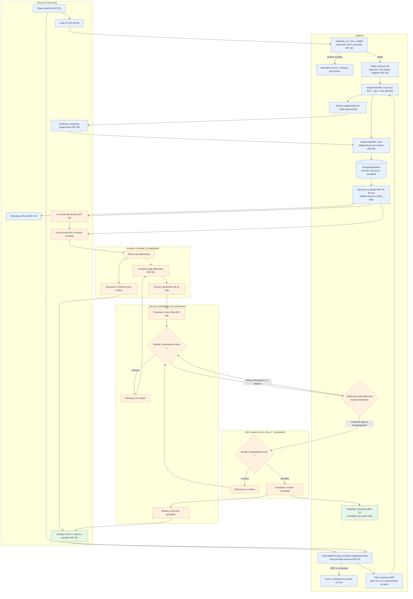
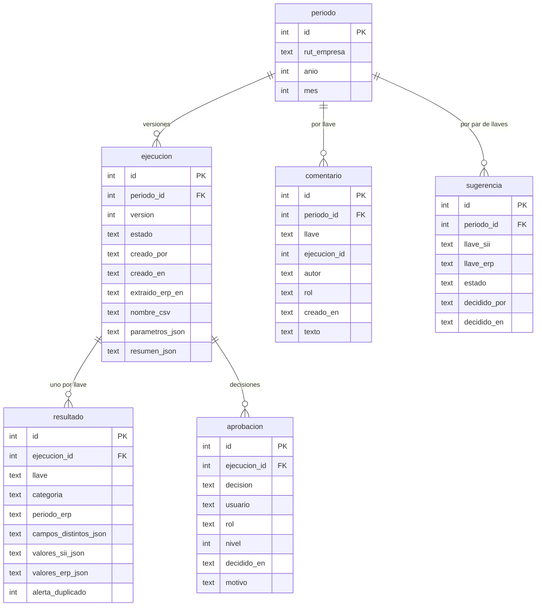
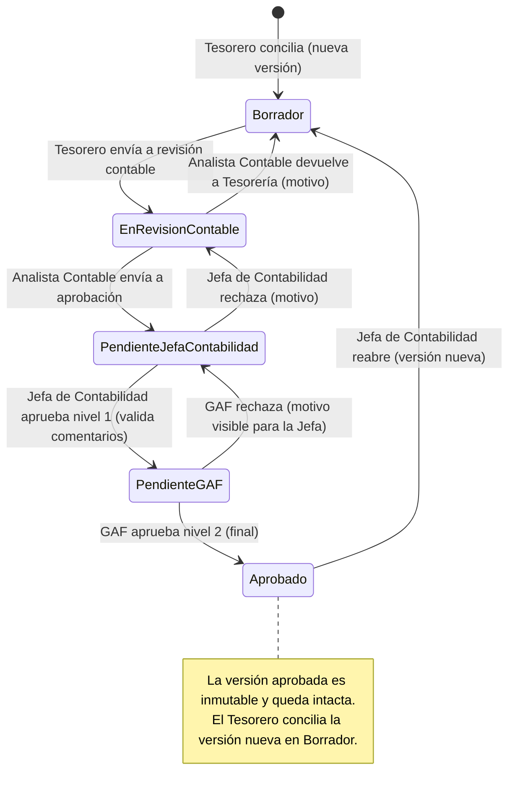

# Arquitectura · Conciliador RCV SII vs Business Central

**Fecha:** 2026-10-19 · **Fase:** 2 · Diseño · **Product Owner:** Miguel Cortés · Fuentes: [PRD.md](PRD.md), [historias.md](historias.md)

Este documento define cómo se construye la PoC de ConciliaSII: una app Python + Streamlit que cruza el Registro de Compras (RCV) del SII contra el libro de compras de Business Central (BC), simulado con un CSV detrás de un adaptador. Las decisiones con alternativas y consecuencias están en los [ADR](adr/README.md).

Convenciones: los IDs `RF-xx` y `RN-xx` son los del PRD; `HU-xx` son las historias; `P1`..`P7` son las decisiones pendientes del PRD. Lo que el PRD no define se marca como **Supuesto** (resumen en [Supuestos y brechas](#supuestos-y-brechas-respecto-del-prd)).

## Principios

1. **Lógica pura separada de Streamlit.** El motor (`ingest`, `engine`, `export`, `workflow`) nunca importa `streamlit`; las páginas de `pages/` son delgadas: leen entradas, llaman a un servicio y dibujan el resultado. Todo lo importante se prueba con `pytest` sin levantar la UI.
2. **El ERP detrás de un puerto.** El motor depende de `ErpLedgerPort`, no de un ERP concreto. Hoy lo implementa `csv_adapter`; mañana `bc_api_adapter` (HU-15). Ver [ADR-0002](adr/0002-erp-detras-de-puerto-adaptador.md).
3. **Todo acceso a datos pasa por `storage/repository.py`.** Ningún otro módulo conoce SQLite. Esto permite cambiar el respaldo sin tocar motor, flujo ni páginas. Ver [ADR-0001](adr/0001-persistencia-sqlite-local.md).
4. **Entrega incremental en tres capas**, cada una usable por sí sola. Ver [ADR-0005](adr/0005-entrega-en-tres-capas.md) y [Capas de entrega](#capas-de-entrega).

## Estructura de carpetas

```text
conciliasii/
├── app.py                          # entrada Streamlit: configuración de página, usuario y rol activo, navegación
├── pages/
│   ├── 1_Cargar_y_Conciliar.py     # período, carga CSV SII, traer libro ERP, ejecutar
│   ├── 2_Revision.py               # resumen, detalle por categoría, sugerencias, comentarios, descarga Excel
│   ├── 3_Aprobacion.py             # enviar a revisión, aprobar, rechazar, reabrir
│   └── 4_Historial.py              # períodos, versiones, vista solo lectura
├── src/conciliasii/
│   ├── config.py                   # parámetros (ver "Configuración"); sin dependencias de Streamlit
│   ├── domain/
│   │   ├── models.py               # Periodo, Documento, Categoria, Resultado, Sugerencia, Comentario...
│   │   └── errors.py               # ArchivoInvalidoError, ComentariosFaltantesError, TransicionInvalidaError...
│   ├── ingest/
│   │   └── sii_csv.py              # lectura y validación del CSV del SII; normalización de RUT
│   ├── erp/
│   │   ├── port.py                 # ErpLedgerPort (Protocol)
│   │   ├── csv_adapter.py          # libro de BC simulado desde CSV
│   │   └── bc_api_adapter.py       # stub de la API real (HU-15)
│   ├── engine/
│   │   ├── matcher.py              # filtro de universo, llave, cruce, vecinos, duplicados, sugerencias
│   │   ├── classifier.py           # asigna una categoría por documento (RN-05, RN-06)
│   │   ├── service.py              # ejecutar_conciliacion y decisiones sobre sugerencias (servicio de aplicación)
│   │   └── summary.py              # resumen por categoría, detalle y filtros (RF-06, RF-07)
│   ├── export/
│   │   └── excel.py                # arma el libro Excel con openpyxl (devuelve bytes)
│   ├── workflow/
│   │   └── approval.py             # estados, permisos por rol, comentarios obligatorios, aprobar/rechazar/reabrir
│   └── storage/
│       ├── schema.sql              # DDL de SQLite
│       └── repository.py           # interfaz del repositorio + implementación SQLite
├── data/samples/                   # CSV de ejemplo del SII y del libro de BC simulado
├── tests/                          # pytest: ingest, matcher, classifier, excel, approval, repository
├── requirements.txt                # streamlit, pandas, openpyxl
├── requirements-dev.txt            # ruff, pytest
└── pyproject.toml                  # configuración de ruff
```

Reglas de dependencia (de afuera hacia adentro; nunca al revés):

```text
pages/ , app.py  ->  workflow, engine, ingest, export, erp (puerto), storage (interfaz)  ->  domain
```

`domain` no importa nada del proyecto. `engine` no conoce `storage` ni `erp.csv_adapter`: recibe listas de `Documento` ya cargadas. Un servicio de aplicación (función `ejecutar_conciliacion(...)` en `engine/service.py`, sin Streamlit) orquesta ingest, puerto, matcher, clasificador y repositorio; las páginas solo lo invocan.

Instalación de dependencias y calidad de código:

```bash
pip install -r requirements-dev.txt
ruff check .             # lint (E, F, I, B, UP)
ruff format --check .    # verifica formato sin modificar
pytest
```

La configuración de ruff vive en [`pyproject.toml`](../pyproject.toml) (línea de 100, `py311`). Ver [ADR-0004](adr/0004-ruff-lint-formato.md).

## Roles y responsabilidades

El flujo tiene **cuatro usuarios de negocio**: el **Tesorero** concilia; el **Tesorero, el Analista Contable y la Jefa de Contabilidad** comentan las diferencias; la **Jefa de Contabilidad** da la primera aprobación (nivel 1) y el **Gerente de Administración y Finanzas (GAF)**, superior jerárquico de la Jefa de Contabilidad, da la segunda y última (nivel 2). Cada acción de la app la ejecuta un rol definido; el [flujo](#flujo-completo) y la [máquina de estados](#flujo-de-aprobación) lo muestran paso a paso.

Confirmado por el PO el 2026-10-19: los cuatro roles, los dos niveles de aprobación, que comentan el Tesorero, el Analista Contable y la Jefa de Contabilidad, que el rechazo del GAF vuelve a la Jefa y el de la Jefa al Analista Contable, que solo el Analista Contable devuelve a Tesorería, que la Jefa reabre sin visto bueno del GAF y que el GAF es su superior jerárquico. El GAF solo lee los comentarios (supuesto menor, no consultado). Ver [ADR-0006](adr/0006-roles-y-cadena-de-aprobacion.md).

| Rol | Área | Qué hace | Qué NO puede hacer | Estados en los que actúa |
| --- | --- | --- | --- | --- |
| Tesorero | Tesorería | Responsable de la conciliación: elige el período, carga el CSV del SII, trae el libro del ERP y concilia, decide las sugerencias de calce, vuelve a conciliar tras corregir en BC, comenta diferencias, descarga el Excel y envía el período a revisión contable | Aprobar, rechazar ni reabrir | `Borrador`; comenta también en `EnRevisionContable` y `PendienteJefaContabilidad` |
| Analista Contable | Contabilidad | Revisa las diferencias, las comenta (el comentario es obligatorio por diferencia) y envía el período a aprobación de la Jefa de Contabilidad; si la conciliación está mal, la devuelve a Tesorería con motivo (solo él puede hacerlo) | Conciliar, decidir sugerencias, aprobar ni reabrir | `EnRevisionContable`; comenta también en `Borrador` y `PendienteJefaContabilidad` |
| Jefa de Contabilidad (1er aprobador, nivel 1) | Contabilidad | Valida que toda diferencia tenga comentario y aprueba el nivel 1, o rechaza con motivo (vuelve al Analista Contable); recibe los rechazos del GAF; puede comentar mientras evalúa; reabre un período aprobado sin visto bueno del GAF | Conciliar ni dar la aprobación final | `PendienteJefaContabilidad` y `Aprobado` (reabrir) |
| GAF (Gerente de Administración y Finanzas; 2.º aprobador, nivel 2 y final) | Superior jerárquico de la Jefa de Contabilidad | Segundo y último aprobador: aprobación final del período; tras ella la versión queda inmutable. Puede rechazar con motivo y el período vuelve a la Jefa de Contabilidad; lee los comentarios | Conciliar, comentar, aprobar el nivel 1 ni reabrir | `PendienteGAF` |
| Administrador | TI | Configura la conexión con la API de Business Central (HU-15). Está en el PRD (sección "Usuarios y roles", con "supuesto") | No participa del flujo de conciliación ni de aprobación | Ninguno |

El Administrador (TI) se mantiene porque el PRD lo define y HU-15 lo usa. En la PoC no tiene pantalla: la configuración del adaptador se lee de variables de entorno o `st.secrets` (ver [Configuración](#configuración)), de modo que el selector de rol de la app ofrece cuatro roles: Tesorero, Analista Contable, Jefa de Contabilidad y GAF.

### Matriz de permisos por acción

`Ejecuta` = puede hacerlo; `Consulta` = solo lectura; `-` = no puede. El estado indica cuándo se puede ejecutar. El servicio (`workflow/approval.py`) valida rol y estado en cada acción; la UI solo oculta o deshabilita lo que no corresponde.

| Acción | Tesorero | Analista Contable | Jefa de Contabilidad | GAF | Administrador (TI) | Estado requerido | Capa |
| --- | --- | --- | --- | --- | --- | --- | --- |
| Seleccionar período y cargar el CSV del SII | Ejecuta | - | - | - | - | Sin versión vigente, o `Borrador` | 1 |
| Conciliar (traer libro del ERP y cruzar) | Ejecuta | - | - | - | - | Sin versión vigente, o `Borrador` | 1 |
| Aceptar o descartar sugerencia de calce | Ejecuta | - | - | - | - | `Borrador` | 1 |
| Ver resumen y detalle | Consulta | Consulta | Consulta | Consulta | - | Cualquiera | 1 |
| Descargar Excel | Ejecuta | Ejecuta | Ejecuta | Ejecuta | - | Cualquiera | 1 |
| Comentar una diferencia | Ejecuta | Ejecuta | Ejecuta | - | - | `Borrador`, `EnRevisionContable` o `PendienteJefaContabilidad` | 2 |
| Enviar a revisión contable | Ejecuta | - | - | - | - | `Borrador` | 2 |
| Enviar a aprobación de la Jefa | - | Ejecuta | - | - | - | `EnRevisionContable` | 2 |
| Devolver a Tesorería (con motivo) | - | Ejecuta | - | - | - | `EnRevisionContable` a `Borrador` | 2 |
| Aprobar nivel 1 (valida comentarios) | - | - | Ejecuta | - | - | `PendienteJefaContabilidad` | 2 |
| Rechazar nivel 1 (con motivo) | - | - | Ejecuta | - | - | `PendienteJefaContabilidad` a `EnRevisionContable` | 2 |
| Aprobar nivel 2 (final) | - | - | - | Ejecuta | - | `PendienteGAF` | 2 |
| Rechazar nivel 2 (con motivo) | - | - | - | Ejecuta | - | `PendienteGAF` a `PendienteJefaContabilidad` | 2 |
| Volver a conciliar (nueva versión) | Ejecuta | - | - | - | - | `Borrador`, o `Aprobado` tras reabrir | 3 |
| Ver historial y versiones | Consulta | Consulta | Consulta | Consulta | - | Cualquiera | 3 |
| Configurar la conexión con BC | - | - | - | - | Ejecuta | No aplica | 1 (variables de entorno y stub) |

Los permisos por rol se entregan por capa. En la **Capa 1** solo existe el Tesorero (el selector ofrece ese rol); no hay comentarios ni flujo de aprobación todavía. Los comentarios son HU-11 y pertenecen a la **Capa 2**, así que el permiso del Tesorero para comentar se activa en la Capa 2, junto con los roles Analista Contable, Jefa de Contabilidad y GAF (este último solo lee), `workflow/approval.py`, la tabla de permisos y los errores de rol. En la **Capa 3** los cuatro roles consultan el historial.

### Alineación con el PRD, las historias y los issues

Con la confirmación del PO se ajustaron `PRD.md` (v0.4), `historias.md` y los issues de GitHub #4 a #16 (el cuerpo de cada uno, sin cambiar etiquetas ni estado), y se agregó HU-16 (issue #19).

- **PRD:** roles, RF-09 (comentan Tesorero, Analista Contable y Jefa de Contabilidad), RF-12, RF-13 (Excel), RN-11 (aprobación en dos niveles, estados en que se comenta y destino de cada rechazo), P1, P6 y P8 (resueltas) y los diagramas de flujo.
- **Historias:** HU-02 a HU-14 usan los roles nuevos; HU-11 y HU-14 se reescribieron según lo aprobado y HU-16 es nueva. **HU-01 y HU-15 se mantienen genéricas** por decisión del PO: HU-01 habla de un "analista de Tesorería", que en este diseño es el Tesorero, y HU-15 del administrador de TI; su tratamiento de rol aquí también es genérico. Los issues #3 y #17 no se modificaron.

## Flujo completo

Cada carril indica quién ejecuta el paso. "Sistema" agrupa lo que hace la app sin intervención de una persona.



Colores: azul = Capa 1, naranja = Capa 2, verde = Capa 3. El ciclo de corrección (RF-10) pasa siempre por el Tesorero, que corrige en Business Central, trae el libro de nuevo y cruza una versión nueva. Llegan a él la devolución del Analista Contable y la reapertura que decide la Jefa de Contabilidad. El rechazo del GAF vuelve a la Jefa y el de la Jefa al Analista Contable (ver [Flujo de aprobación](#flujo-de-aprobación)). La validación del comentario obligatorio ocurre al aprobar el nivel 1.

## Contratos de entrada

Todos los CSV son UTF-8, separados por `;`, con montos enteros en CLP (sin decimales ni separador de miles) y fechas `AAAA-MM-DD`.

### Registro de Compras del SII (propuesto)

El PRD no define columnas; esta es la propuesta para la PoC (**Supuesto**, PRD: "el formato del CSV del SII se mantiene estable").

| Columna | Uso |
| --- | --- |
| `Tipo Doc` | Tipo de documento (33, 34; el resto se excluye, RF-04) |
| `RUT Proveedor` | RUT emisor; parte de la llave (RN-03), se normaliza |
| `Razon Social` | Nombre del proveedor (informativo) |
| `Folio` | Parte de la llave |
| `Fecha Docto` | Fecha de emisión (campo comparado, RN-04) |
| `Fecha Recepcion` | Fecha de recepción en el SII (informativa) |
| `Monto Exento` | Campo comparado (RN-04) |
| `Monto Neto` | Campo comparado (RN-04) |
| `Monto IVA Recuperable` | Campo comparado (RN-04) |
| `Monto Total` | Campo comparado (RN-04); base del calce aproximado (RN-08) |

Brechas de este contrato frente al PRD (todas **Supuesto**, se cierran con los CSV reales del SII):

- RF-02 exige validar RUT y período del archivo, y RF-04 exige filtrar por estado "Registro". La lista propuesta no trae esos datos. Para la PoC el archivo incluye tres columnas adicionales: `RUT Receptor`, `Periodo` (`AAAA-MM`) y `Estado` (`Registro`, `Pendiente`, `Reclamado`, `No incluir`). Si el export real no las trae, el RUT y el período saldrían del nombre del archivo o de un formulario, y el estado de la pestaña del portal desde donde se descargó.
- RN-04 también valida IVA no recuperable (código y monto), IVA de uso común y otros impuestos (código, tasa y monto). Quedan como columnas opcionales (`Codigo IVA No Rec`, `Monto IVA No Rec`, `Monto IVA Uso Comun`, `Codigo Otro Impuesto`, `Tasa Otro Impuesto`, `Monto Otro Impuesto`); si faltan se asumen en cero. El conjunto de campos comparados es una lista en `config.py` para ampliarla sin tocar el clasificador.
- La detección de formato (HU-02, "Formato no reconocido") usa las diez columnas propuestas como obligatorias y reporta cuáles faltan.

### Libro de compras de BC simulado (propuesto)

| Columna | Uso |
| --- | --- |
| `Entry No.` | Número interno del movimiento; se muestra en alertas de duplicado (RN-09) y en "Sin llave" (HU-03) |
| `Posting Date` | Fecha de registro contable; candidata a definir el período (P2) |
| `Document Date` | Fecha del documento; candidata a definir el período (P2) y se compara con `Fecha Docto` |
| `Document No.` | Número del documento en BC (informativo) |
| `External Document No.` | Número del documento del proveedor (respaldo para derivar tipo y folio, ver P7) |
| `VAT Registration No.` | RUT del proveedor; parte de la llave |
| `Vendor Name` | Nombre del proveedor (informativo) |
| `DTE Type` | Tipo de documento; parte de la llave |
| `DTE Folio` | Folio; parte de la llave |
| `Amount Excl. VAT` | Base imponible o exenta (ver mapeo) |
| `VAT Amount` | IVA |
| `Amount Incl. VAT` | Total |

Mapeo del adaptador a `Documento` (**Supuesto**, el PRD no define los campos de BC): `Amount Excl. VAT` es `monto_neto` en documentos 33 y `monto_exento` en documentos 34; `VAT Amount` es `monto_iva_recuperable`; `Amount Incl. VAT` es `monto_total`; `Entry No.` se guarda como `Documento.nro_movimiento`. Así un tipo 34 con IVA distinto de cero en BC queda en Diferencia de monto con el campo "IVA" distinto (HU-05, RN-04). Solo se leen facturas registradas (RN-02); el CSV simulado ya las contiene.

Si P7 muestra que la API estándar de BC no expone tipo de documento ni folio, `bc_api_adapter` los deriva de `External Document No.` (y el RUT del proveedor desde la ficha). Esa derivación queda encapsulada en `erp/`: el motor sigue recibiendo `Documento` con `rut`, `tipo_doc` y `folio`. Si falta alguno, el documento se informa como "Sin llave" y no participa del cruce (HU-03, HU-15).

## Puerto del ERP

```python
class ErpLedgerPort(Protocol):
    def get_purchase_ledger(self, period: Periodo) -> list[Documento]:
        """Facturas de compra registradas cuyo período (ERP_PERIOD_DATE_FIELD) coincide con `period`."""
```

- `csv_adapter` lee el CSV simulado, aplica el mapeo y filtra por el período según `ERP_PERIOD_DATE_FIELD`.
- `bc_api_adapter` es un stub que lanza `NotImplementedError` con un mensaje claro; su forma (autenticación, paginación, derivación de llave) se diseña cuando se cierre P7.
- Los períodos vecinos (RN-07) los resuelve el servicio de aplicación llamando al puerto una vez por período del rango; el puerto no conoce la lógica de vecinos.
- La fecha y hora de extracción y la cantidad de documentos (RF-03) las mide el servicio de aplicación y se guardan en la ejecución.
- Los errores del ERP se propagan como `ErpNoDisponibleError` con la causa; el CSV del SII ya cargado se conserva para reintentar (HU-03).

## Configuración

`config.py` lee variables de entorno (con `st.secrets` solo en la capa de las páginas, nunca en el motor).

| Parámetro | Valor por defecto | Decisión relacionada |
| --- | --- | --- |
| `EMPRESA_RUT` | RUT de la empresa de ejemplo | RF-02: validar el RUT receptor del archivo |
| `ERP_BACKEND` | `csv` (`bc_api` más adelante) | HU-15 |
| `ERP_CSV_PATH` | `data/samples/libro_bc.csv` | |
| `ERP_PERIOD_DATE_FIELD` | `posting_date` (o `document_date`) | **P2**: qué fecha define el período. El valor por defecto es un supuesto |
| `AMOUNT_TOLERANCE` | `0` (comparación exacta) | **P3**: exacto o ±$1 |
| `NEIGHBOR_PERIODS` | `2,1` (2 anteriores y 1 siguiente) | **P4**: propuesta del PRD |
| `STORAGE_BACKEND` | `sqlite` | ADR-0001 |
| `SQLITE_PATH` | `data/conciliasii.db` | ADR-0001 |
| `CAMPOS_COMPARADOS` | lista de RN-04 disponible en los CSV | RN-04 |

Las decisiones P2, P3 y P4 se cierran cambiando un valor, no código. P5 (volumen) solo afecta el rendimiento esperado: con unos cientos de documentos al mes el cruce en memoria con pandas o diccionarios toma segundos. P6 (Excel) se trata en [Exportación a Excel](#exportación-a-excel).

## Motor de conciliación

1. **Normalizar la llave** (RN-03): RUT sin puntos, con guion y dígito verificador en mayúscula; llave = `rut|tipo_doc|folio`.
2. **Filtrar el universo** (RN-01, RF-04): SII solo tipos 33 y 34 en estado Registro; ERP solo tipos 33 y 34. Se cuentan los excluidos por tipo y por estado. Los documentos de BC sin llave van a una lista aparte "Sin llave".
3. **Detectar duplicados** (RN-09): una llave repetida dentro de la misma fuente se marca como alerta dentro de su categoría y conserva los `Entry No.`.
4. **Cruzar**: por llave, contra el ERP del período y los períodos vecinos (RN-07).
5. **Clasificar** (`classifier.py`, RN-05 y RN-06), con esta precedencia para que cada documento caiga en exactamente una categoría (RF-05):
   - llave solo en SII (ni en el período ni en los vecinos de BC): **Solo en SII**;
   - llave solo en BC dentro del período: **Solo en ERP**;
   - llave en ambos, pero BC la tiene en otro período: **Diferencia de período** (si además hay montos distintos, igual es Diferencia de período y el detalle lista los campos distintos, RN-06);
   - llave en ambos y en el mismo período con algún campo distinto (según `AMOUNT_TOLERANCE`): **Diferencia de monto**;
   - llave en ambos y todos los campos iguales: **Cuadrado**.
6. **Sugerir calces aproximados** (`matcher.py`, RN-08, RF-08): solo entre Solo en SII y Solo en ERP con el mismo RUT y el mismo monto total. Una sugerencia no cambia nada hasta que el usuario la confirme; al confirmar, ambos documentos pasan a Diferencia de monto con folio o tipo como campo distinto. Un descarte no vuelve a mostrarse en ese período.

Invariante verificable (HU-05): la suma de documentos de todas las categorías es igual al universo filtrado.

**Supuesto:** la búsqueda en períodos vecinos se hace del SII hacia BC, porque el CSV cargado cubre un solo período. Un documento de BC del período que no está en el CSV es Solo en ERP, aunque el SII lo tenga en otro mes; detectar ese caso exigiría otros CSV del SII. Conviene confirmarlo con el PO al cerrar P4.

## Exportación a Excel

`export/excel.py` expone una función pura que recibe la ejecución, sus resultados (y, desde la Capa 2, comentarios y estado) y devuelve los bytes de un `.xlsx` armado con **openpyxl**. No importa Streamlit. La página `2_Revision.py` lo entrega con `st.download_button`, de modo que el usuario se lleva el resultado aunque la base local se pierda. Es el requisito RF-13 del PRD (P6 resuelta: la exportación está en el alcance del MVP) y lo cubre HU-16. Pueden descargarlo el Tesorero, el Analista Contable, la Jefa de Contabilidad y el GAF (el Administrador no participa del flujo) (ver [Limitaciones conocidas](#limitaciones-conocidas)). Detalle de la decisión en [ADR-0003](adr/0003-exportacion-excel-openpyxl.md).

Hojas del libro:

| Hoja | Contenido |
| --- | --- |
| `Resumen` | Período, versión, estado, fecha de extracción del ERP, universo y excluidos por tipo y por estado; por categoría: cantidad y montos SII vs ERP (RF-06) con totales; "Sin llave"; desde la Capa 2, avance de comentarios |
| `Cuadrado`, `Diferencia de monto`, `Diferencia de período`, `Solo en SII`, `Solo en ERP` | Una hoja por categoría, una fila por documento: llave, valores SII y ERP lado a lado, campos distintos, diferencia calculada, alerta de duplicado y `Entry No.`; filtros automáticos y fila de encabezado fija |
| `Sugerencias` | Calces aproximados con su estado (pendiente, confirmada, descartada) |
| `Comentarios` (Capa 2) | Un comentario por fila: llave, autor, rol, fecha y hora, texto |

Desde la Capa 2 las hojas de categoría suman una columna "Comentarios" (comentarios concatenados por documento) y el resumen incluye el estado y, si existe, quién aprobó y cuándo.

Los comentarios y el estado de aprobación se incluyen cuando existen (Capa 2); en la Capa 1 el libro tiene el resumen, el detalle por categoría y las sugerencias.

## Modelo de datos (SQLite)

Cinco tablas del diseño base más una auxiliar para las sugerencias de calce (**Supuesto**: HU-07 exige recordar quién confirmó o descartó y no mostrar de nuevo un descarte). El DDL vive en `storage/schema.sql`.



| Tabla | Notas |
| --- | --- |
| `periodo` | Único por `(rut_empresa, anio, mes)`. Una empresa en el MVP. |
| `ejecucion` | Una fila por versión (`version` 1, 2, 3...) de un período (RN-10). `estado` toma `Borrador`, `EnRevisionContable`, `PendienteJefaContabilidad`, `PendienteGAF` o `Aprobado`. Guarda el nombre del CSV, la fecha de extracción del ERP, los parámetros usados (tolerancia, campo de período, vecinos), el resumen y los conteos de excluidos y de "Sin llave". La versión vigente es la de mayor `version`. |
| `resultado` | Un documento clasificado en una versión: exactamente una `categoria` (RF-05), `alerta_duplicado`, valores SII y ERP y campos distintos. `UNIQUE(ejecucion_id, llave)`. |
| `comentario` | Solo se inserta, nunca se actualiza ni se borra (RF-09). `autor` y `rol` registran quién comentó (Tesorero o Analista Contable). Se asocia al `periodo_id` y la `llave`, no a una versión: así se conservan al volver a conciliar (RF-10, RN-10). `ejecucion_id` registra en qué versión se escribió; una versión N solo muestra comentarios de versiones menores o iguales a N, por lo que una versión aprobada no cambia. |
| `aprobacion` | Registro de decisiones sobre una versión, con `usuario`, `rol`, fecha y hora y `motivo`: `AprobadoNivel1` (`nivel` 1, Jefa de Contabilidad), `AprobadoNivel2` (`nivel` 2, GAF), `Rechazado` (`nivel` 1 o 2 según quién rechaza; `motivo` obligatorio), `Devuelto` (Analista Contable a Tesorería; `nivel` nulo; `motivo` obligatorio) y `Reabierto` (Jefa de Contabilidad; `nivel` 1) (HU-14). No es una pista de auditoría completa (fuera de alcance, P6). |
| `sugerencia` | Par `(llave_sii, llave_erp)` con estado `Pendiente`, `Confirmada` o `Descartada`, y quién y cuándo decidió (HU-07). Pertenece al período, de modo que un descarte persiste entre versiones. |

El nombre del usuario y su rol (Tesorero, Analista Contable, Jefa de Contabilidad o GAF) se obtienen de un selector en la barra lateral (**Supuesto**: sin autenticación real en la PoC; el PRD marca la gestión de usuarios como supuesto del Administrador). En la Capa 1 el selector solo ofrece Tesorero.

### Interfaz del repositorio

Todo el acceso a datos pasa por una interfaz (`Protocol`) definida en `storage/repository.py`; `SqliteRepository` es la única implementación de la PoC. Motor, flujo y páginas dependen de la interfaz, nunca de `sqlite3`. Las páginas obtienen la instancia con una fábrica que lee `STORAGE_BACKEND`.

```python
class ConciliacionRepository(Protocol):
    # Capa 1
    def obtener_o_crear_periodo(self, rut: str, anio: int, mes: int) -> Periodo: ...
    def crear_ejecucion(
        self, periodo_id: int, meta: MetaEjecucion, resultados: list[Resultado]
    ) -> Ejecucion: ...
    def ejecucion_vigente(self, periodo_id: int) -> Ejecucion | None: ...
    def listar_resultados(self, ejecucion_id: int) -> list[Resultado]: ...
    def guardar_decision_sugerencia(self, periodo_id: int, sugerencia: Sugerencia) -> None: ...
    def listar_sugerencias(self, periodo_id: int) -> list[Sugerencia]: ...
    # Capa 2
    def agregar_comentario(
        self, periodo_id: int, llave: str, ejecucion_id: int, autor: str, rol: Rol, texto: str
    ) -> Comentario: ...
    def listar_comentarios(self, periodo_id: int, hasta_version: int) -> list[Comentario]: ...
    def cambiar_estado(self, ejecucion_id: int, estado: Estado) -> None: ...
    def registrar_decision(
        self,
        ejecucion_id: int,
        decision: Decision,
        usuario: str,
        rol: Rol,
        nivel: int | None,
        motivo: str | None,
    ) -> None: ...
    # Capa 3
    def listar_periodos(self) -> list[ResumenPeriodo]: ...
    def listar_ejecuciones(self, periodo_id: int) -> list[Ejecucion]: ...
```

Las firmas son una propuesta; lo que se fija es la frontera (nada fuera de `storage/` sabe cómo se persiste). Cada operación que cambia varias filas (crear ejecución con sus resultados, aprobar) debe ser atómica dentro del repositorio.

## Flujo de aprobación

Los estados viven en `ejecucion.estado` y las transiciones en `workflow/approval.py`. Cada transición la dispara un rol concreto (ver la [matriz de permisos](#matriz-de-permisos-por-acción)).



Reglas (P1, HU-14):

- **Quién puede qué.** El Tesorero concilia, decide las sugerencias de calce, comenta y envía a revisión contable. El Analista Contable comenta y envía a la Jefa, o devuelve a Tesorería. La Jefa de Contabilidad comenta si hace falta, aprueba el nivel 1, rechaza o reabre. El GAF aprueba el nivel 2 o rechaza. Ver [Roles y responsabilidades](#roles-y-responsabilidades).
- **Comentarios.** Pueden escribirlos el Tesorero, el Analista Contable y la Jefa de Contabilidad mientras la versión está en `Borrador`, `EnRevisionContable` o `PendienteJefaContabilidad`. El GAF solo los lee (supuesto menor). Se registran con autor y rol; no se editan ni se borran (RF-09, RN-11).
- **Comentario obligatorio por diferencia: se valida al aprobar el nivel 1.** El PRD condiciona la aprobación a los comentarios: P1 (`PRD.md`, línea 136: el nivel 1 "no puede aprobar si quedan diferencias sin comentario"), RN-11 (línea 115) y la métrica "Diferencias sin comentario al cierre = 0" (línea 127). `aprobar_nivel1()` solo procede si todo `resultado` cuya categoría no es Cuadrado tiene al menos un comentario no vacío (tras `strip()`) para su llave. Si no, lanza `ComentariosFaltantesError` con la lista de documentos pendientes y la cantidad que falta (HU-14). El GAF recibe el período ya comentado.
- **Doble barrera.** La UI deshabilita "Aprobar nivel 1" mientras haya pendientes, y el servicio vuelve a validar al ejecutar. Por defensa, `aprobar_nivel2()` repite la validación (los comentarios no se pueden borrar, así que en la práctica no falla). La regla no depende de la interfaz. El Analista Contable no queda bloqueado al enviar a la Jefa: la UI solo le advierte cuántas diferencias siguen sin comentario.
- **Funciones del servicio** (`workflow/approval.py`): `enviar_a_revision_contable`, `enviar_a_jefa`, `devolver_a_tesoreria`, `aprobar_nivel1`, `rechazar_nivel1`, `aprobar_nivel2`, `rechazar_nivel2`, `reabrir`, `agregar_comentario`. Todas reciben el actor (usuario y rol) y consultan la tabla de permisos.
- **Permisos por rol.** Si el rol no corresponde se lanza `RolNoAutorizadoError`; si el estado no corresponde, `TransicionInvalidaError`; si falta el motivo, `MotivoRequeridoError`. El Tesorero y el Analista Contable no ven la opción de aprobar.
- **Rechazos y devoluciones.** Todo rechazo exige un motivo (texto no vacío), que queda en `aprobacion` con rol y nivel y se muestra al destinatario. **Confirmado (P8):** el rechazo del GAF vuelve a la Jefa de Contabilidad (`PendienteJefaContabilidad`), que puede volver a aprobar el nivel 1 o rechazar; el rechazo de la Jefa vuelve al Analista Contable (`EnRevisionContable`); y solo el Analista Contable puede devolver a Tesorería (`Borrador`) cuando el problema está en la conciliación misma.
- **Inmutabilidad.** Una versión `Aprobado` no admite nuevos comentarios, cambios de sugerencias ni modificaciones de resultados; el servicio lanza `TransicionInvalidaError`. Una corrección es una **versión nueva**.
- **Reabrir.** **Confirmado:** la reapertura la decide la Jefa de Contabilidad, sin aviso ni visto bueno del GAF. Registra una decisión `Reabierto` que habilita al Tesorero a crear una versión nueva en `Borrador`; la versión aprobada queda intacta.
- **Reconciliar.** Un período con versión vigente `Aprobado` (y sin `Reabierto` posterior) no se puede volver a conciliar. Mientras la versión está en `EnRevisionContable`, `PendienteJefaContabilidad` o `PendienteGAF` tampoco: primero debe devolverse hasta `Borrador`.

Errores del módulo (`domain/errors.py`): `ComentariosFaltantesError`, `RolNoAutorizadoError`, `TransicionInvalidaError`, `MotivoRequeridoError`.

## Capas de entrega

Cada capa deja la app usable y se puede liberar por separado. Detalle y alternativas en [ADR-0005](adr/0005-entrega-en-tres-capas.md).

- **Capa 1 · Núcleo con descarga Excel.** Cargar el CSV del SII, traer el libro del ERP por el puerto, filtrar, cruzar, clasificar, sugerir calces, ver resumen y detalle, y descargar el Excel.
- **Capa 2 · Comentarios y aprobación.** Comentarios por documento (Tesorero y Analista Contable) y aprobación del período en dos niveles (Jefa de Contabilidad y GAF) con comentario obligatorio por diferencia. Agrega los roles Analista Contable, Jefa de Contabilidad y GAF y activa el permiso de comentar del Tesorero; la Capa 1 solo conoce al Tesorero sin comentarios.
- **Capa 3 · Historial y versiones.** Lista de períodos, versiones, volver a conciliar conservando comentarios y vista de versiones anteriores en solo lectura.

### Historias por capa

Cada historia está en exactamente una capa. Los issues #3 a #17 corresponden a HU-01 a HU-15 en ese orden (issue = HU + 2); HU-16 es el issue #19 (el #18 es el pull request).

| Issue | HU | Título | MoSCoW | Capa | Justificación breve | Dependencias / decisiones pendientes |
| --- | --- | --- | --- | --- | --- | --- |
| [#3](https://github.com/miguel-cortes-14/conciliasii/issues/3) | HU-01 | Seleccionar el período a conciliar | Must | 1 | Todo lo demás cuelga del período; sin él no hay carga ni cruce | Repositorio (`periodo`); el escenario "período ya conciliado" muestra la última versión guardada |
| [#4](https://github.com/miguel-cortes-14/conciliasii/issues/4) | HU-02 | Cargar el CSV del Registro de Compras | Must | 1 | Primer insumo del cruce (`ingest/sii_csv.py`) | HU-01; formato del CSV (supuesto, ver contratos) |
| [#5](https://github.com/miguel-cortes-14/conciliasii/issues/5) | HU-03 | Traer el libro de compras desde Business Central | Must | 1 | Segundo insumo, vía `ErpLedgerPort` y `csv_adapter` | HU-01; **P2**; **P7** (campos de llave) |
| [#6](https://github.com/miguel-cortes-14/conciliasii/issues/6) | HU-04 | Filtrar el universo a conciliar | Must | 1 | Define el universo que se cruza (RN-01) | HU-02, HU-03 |
| [#7](https://github.com/miguel-cortes-14/conciliasii/issues/7) | HU-05 | Cruzar y clasificar documentos | Must | 1 | Núcleo del producto (`matcher`, `classifier`) | HU-04; **P3** |
| [#8](https://github.com/miguel-cortes-14/conciliasii/issues/8) | HU-06 | Detectar diferencias de período | Should | 1 | Es una de las 5 categorías de RN-05 y el clasificador la necesita desde el inicio; no vale la pena una segunda pasada sobre el motor | HU-05; **P4**, **P2** |
| [#9](https://github.com/miguel-cortes-14/conciliasii/issues/9) | HU-07 | Sugerir calces aproximados | Could | 1 | Es lógica del cruce (`matcher`) sobre Solo en SII y Solo en ERP; se registra quién decide con el usuario del selector | HU-05; tabla `sugerencia` |
| [#10](https://github.com/miguel-cortes-14/conciliasii/issues/10) | HU-08 | Alertar documentos duplicados | Could | 1 | Se detecta al armar el cruce (RN-09); costo marginal bajo | HU-05 |
| [#11](https://github.com/miguel-cortes-14/conciliasii/issues/11) | HU-09 | Ver el resumen por categoría | Must | 1 | Primera vista de resultados y base de la hoja `Resumen` del Excel | HU-05; el escenario "avance de comentarios" se activa en la Capa 2 |
| [#12](https://github.com/miguel-cortes-14/conciliasii/issues/12) | HU-10 | Ver el detalle de diferencias | Must | 1 | Permite investigar la causa, valores lado a lado | HU-05; el filtro "sin comentario" se activa en la Capa 2 |
| [#13](https://github.com/miguel-cortes-14/conciliasii/issues/13) | HU-11 | Comentar un documento | Must | 2 | Primer paso de la revisión: lo escriben el Tesorero, el Analista Contable y la Jefa de Contabilidad (el GAF solo lee); requiere tabla `comentario`, usuario y rol | HU-10 |
| [#14](https://github.com/miguel-cortes-14/conciliasii/issues/14) | HU-12 | Volver a conciliar un período | Should | 3 | Gestión de versiones y traspaso de comentarios por llave (RN-10); presupone comentarios (Capa 2) | HU-05, HU-11; `ejecucion.version` |
| [#15](https://github.com/miguel-cortes-14/conciliasii/issues/15) | HU-13 | Consultar conciliaciones anteriores | Should | 3 | Historial por período (RF-11), solo consulta | HU-01, HU-12, HU-14 (estado en la lista) |
| [#16](https://github.com/miguel-cortes-14/conciliasii/issues/16) | HU-14 | Aprobar el período | Must | 2 | Cierra el ciclo con comentario obligatorio (P1) en dos niveles: Jefa de Contabilidad (nivel 1, valida comentarios, rechaza y reabre) y GAF (nivel 2, final); depende de los comentarios | HU-11; P1 resuelta |
| [#17](https://github.com/miguel-cortes-14/conciliasii/issues/17) | HU-15 | Configurar la conexión con Business Central | Must | 1 | Habilitador del adaptador del ERP: en la PoC se materializa como `config.py` más el stub `bc_api_adapter`; la conexión real vive detrás del puerto | HU-03; **P7** |
| [#19](https://github.com/miguel-cortes-14/conciliasii/issues/19) | HU-16 | Exportar la conciliación a Excel | Must | 1 | La exportación entró al alcance del MVP (P6 resuelta, RF-13) y es el resultado durable de la demo, cuya base es efímera (ADR-0001); la Capa 1 se define como núcleo con descarga Excel. Must porque el PO la pidió desde el MVP; si se degrada a Should no cambia la capa | HU-05, HU-09; comentarios y estado de aprobación se suman en la Capa 2 (HU-11, HU-14) |

Recuento: 16 historias, 16 filas. Capa 1 = HU-01, 02, 03, 04, 05, 06, 07, 08, 09, 10, 15 y 16 (12 historias); Capa 2 = HU-11 y HU-14 (2); Capa 3 = HU-12 y HU-13 (2). Total 16.

Notas de asignación:

- HU-15 incluye en la PoC solo lo que se puede construir sin un BC real: parámetros, selección del adaptador y el stub. Los escenarios de "probar la conexión", "credenciales inválidas" y "campos de llave" se validan cuando exista `bc_api_adapter` real (depende de P7). Las credenciales nunca se escriben en el repositorio; se leen de variables de entorno o `st.secrets`.
- HU-09 y HU-10 tienen un escenario cada una que depende de comentarios (avance de comentarios; filtro "sin comentario"). Quedan en la Capa 1 con ese escenario inactivo; se completa al entregar HU-11.
- HU-01 incluye el escenario "período ya conciliado", que depende de persistir la ejecución; por eso la Capa 1 ya incluye las tablas `periodo`, `ejecucion` y `resultado`.

### Módulos y archivos por capa

| Capa | Módulos y archivos que se entregan |
| --- | --- |
| 1 | `app.py`; `pages/1_Cargar_y_Conciliar.py`; `pages/2_Revision.py` (resumen, detalle, sugerencias, descarga); `src/conciliasii/config.py`; `domain/models.py` y `domain/errors.py`; `ingest/sii_csv.py`; `erp/port.py`, `erp/csv_adapter.py`, `erp/bc_api_adapter.py` (stub); `engine/matcher.py`, `engine/classifier.py`, `engine/service.py`, `engine/summary.py`; `export/excel.py` (hojas `Resumen`, categorías y `Sugerencias`); `storage/schema.sql` y `storage/repository.py` (`periodo`, `ejecucion`, `resultado`, `sugerencia`); `data/samples/`; `tests/`; `requirements.txt`, `requirements-dev.txt`, `pyproject.toml` |
| 2 | `workflow/approval.py`; `pages/3_Aprobacion.py`; panel de comentarios en `pages/2_Revision.py`; tablas `comentario` y `aprobacion` en `schema.sql` y sus métodos en el repositorio; hoja `Comentarios` y columna de comentarios en `export/excel.py`; selector de rol con los roles Analista Contable, Jefa de Contabilidad y GAF, permisos por rol (`Rol`, `RolNoAutorizadoError`) y estados `EnRevisionContable`, `PendienteJefaContabilidad` y `PendienteGAF` |
| 3 | `pages/4_Historial.py`; en `engine/service.py`, traspaso de comentarios por llave entre versiones y vista de versiones anteriores en solo lectura (`listar_periodos`, `listar_ejecuciones`); acción "volver a conciliar" con versión nueva |

### Coherencia con el MVP del PRD

El conjunto Must son las historias HU-01 a HU-05, HU-09, HU-10, HU-11, HU-14, HU-15 y HU-16. Con esta asignación, todas caen en las Capas 1 y 2 y ninguna Must queda en la Capa 3. Pero la Capa 1 por sí sola no cumple el MVP mínimo: faltan HU-11 y HU-14 (Capa 2), que son las que reemplazan el cierre con Contabilidad y el GAF. El MVP completo del PRD es Capa 1 + Capa 2; la Capa 3 contiene solo historias Should (HU-12, HU-13). Además la Capa 1 adelanta tres historias no Must (HU-06 Should; HU-07 y HU-08 Could) porque forman parte del motor de cruce,; la descarga de Excel (HU-16) ya es parte del alcance del MVP (P6 resuelta).

## Nomenclatura

Las pruebas de `tests/` se escribieron antes que el código y fijan los nombres públicos de esta sección. Los nombres que el diseño ya traía no cambian; los que son nuevos se marcan con (nuevo).

**Convención**

1. **Dominio en español:** modelos, campos, enums, estados, roles, errores y funciones de negocio (`conciliar`, `aprobar_nivel1`, `listar_*`), con verbos en infinitivo.
2. **Inglés solo para:** sufijos de patrón (`Port`, `Adapter`, `Repository`); los nombres que este documento ya fijó en inglés (módulos `matcher`, `classifier`, `approval`, `repository`, `excel`; `get_purchase_ledger`; variables `ERP_*`, `AMOUNT_TOLERANCE`, `NEIGHBOR_PERIODS`); y los nombres literales de la fuente externa, confinados a `erp/` e `ingest/` (`posting_date`, `document_date`, `Entry No.`).
3. **Los módulos se nombran por su rol técnico, en inglés**; su contenido va en español. Los módulos nuevos son `engine/service.py` (`ejecutar_conciliacion` y las decisiones sobre sugerencias) y `engine/summary.py` (resumen y detalle).
4. **El adaptador traduce:** al construir un `Documento`, `Entry No.` pasa a `nro_movimiento`.
5. **`Config`:** cada campo es la variable de entorno en minúsculas, sin traducir (`empresa_rut`, `erp_period_date_field`, `amount_tolerance`, `neighbor_periods`). Un parámetro que repite un concepto de `Config` usa el mismo nombre (`CsvLedgerAdapter(ruta, erp_period_date_field=...)`).
6. **Tipos cerrados:** `Estado` y `Accion` son `StrEnum` con los valores de este documento (`"Borrador"`, `"comentar"`).
7. **Abreviaturas:** nombres completos en `src/`; `repo`, `erp` y `config` se aceptan en fixtures y parámetros locales de prueba.
8. **Enums:** miembros en `MAYUSCULAS_SNAKE` en español; el valor es el texto del PRD (`"Diferencia de período"`).

**Funciones públicas fijadas por las pruebas** (todas (nuevo) salvo `ejecutar_conciliacion`, las de `approval` y las del repositorio, cuyo nombre ya estaba en este documento)

| Función | Módulo | Historias |
| --- | --- | --- |
| `leer_rcv(contenido, periodo, rut_empresa)`, `normalizar_rut(texto)` | `ingest.sii_csv` | HU-02, 04, 05 |
| `filtrar_universo(sii, erp)` → `Universo`, `sugerir_calces(resultados)` | `engine.matcher` | HU-03, 04, 07 |
| `conciliar(sii, erp, periodo, config)` → `Conciliacion` | `engine` | HU-05 a 08 |
| `ejecutar_conciliacion(repo, erp, docs_sii, periodo, actor, config=)`, `confirmar_sugerencia(...)`, `descartar_sugerencia(...)` | `engine.service` | HU-01, 03, 07, 12, 14 |
| `resumir(resultados, llaves_comentadas=)`, `campos_del_detalle(resultado)`, `filtrar_detalle(resultados, rut=, sin_comentario=, llaves_comentadas=)` | `engine.summary` | HU-09, 10 |
| `generar_excel(ejecucion, resultados, sugerencias=, comentarios=, decisiones=)` → `bytes` | `export.excel` | HU-16 |
| `agregar_comentario(repo, ejecucion_id, llave, actor, texto)`, transiciones `(repo, ejecucion_id, actor, motivo=)`, `acciones_permitidas(rol, estado)` | `workflow.approval` | HU-11, 14, 16 |
| `listar_decisiones(ejecucion_id)` (lectura de `aprobacion`) | `storage.repository` | HU-14, 16 |

Clases nuevas: `Config`, `Actor`, `Universo`, `Conciliacion`, `Resumen`, `CsvLedgerAdapter`, `BcApiAdapter`.

## Limitaciones conocidas

- **La base SQLite local no persiste en Streamlit Community Cloud.** El sistema de archivos de esa plataforma es efímero: los datos se pierden al reiniciar, redesplegar, reconstruir la app o cuando la app "se duerme" por inactividad. Por lo tanto, la demo pública no ofrece historial durable, versiones ni aprobaciones que sobrevivan. Esto es una decisión consciente para una PoC, no un defecto; se registra en [ADR-0001](adr/0001-persistencia-sqlite-local.md).
- **Mitigaciones:** la descarga de Excel (ver arriba) permite llevarse el resultado; los CSV de ejemplo en `data/samples/` permiten recargar los datos de la demo; el repositorio es la única frontera de acceso a datos.
- **Mejora futura:** migrar a una base externa administrada (por ejemplo Postgres administrado o Supabase) implementando otro `ConciliacionRepository` y cambiando `STORAGE_BACKEND`, sin tocar motor, flujo ni páginas.
- El libro de BC es simulado con CSV; la integración real depende de P7.
- Sin autenticación real: el usuario y el rol (Tesorero, Analista Contable, Jefa de Contabilidad, GAF) se eligen en la barra lateral, de modo que cualquiera puede asumir cualquier rol. No apto para datos reales.
- Una sola empresa y un solo ambiente de BC, como en el alcance del MVP.

## Verificación contra el PRD

Se comparó la lista de categorías usada en el diseño base con la regla **RN-05** del PRD (`docs/PRD.md`, línea 109, sección "Reglas de negocio").

| # | Categoría en el diseño | Categoría en el PRD (RN-05) | Definición en el PRD | Resultado |
| --- | --- | --- | --- | --- |
| 1 | Cuadrado | **Cuadrado** | llave y campos iguales | Coincide |
| 2 | Diferencia de monto | **Diferencia de monto** | llave igual, algún campo distinto | Coincide |
| 3 | Diferencia de período | **Diferencia de período** | llave igual, período distinto | Coincide |
| 4 | Solo en SII | **Solo en SII** | está en el RCV y no en Business Central | Coincide |
| 5 | Solo en ERP | **Solo en ERP** | está en Business Central y no en el RCV | Coincide |

- **Cantidad:** cinco en ambos. RF-05 (línea 89) exige que cada documento quede en exactamente una categoría; RN-06 (línea 110) fija la precedencia de Diferencia de período sobre Diferencia de monto.
- **Nombres:** idénticos, incluidas tildes y mayúsculas ("Diferencia de período", "Solo en SII", "Solo en ERP").
- **Definiciones:** el diseño usa las de RN-05. Dos precisiones del PRD ya incorporadas: "llave" es RUT emisor + tipo de documento + folio (RN-03, línea 107) y "campos" son los de RN-04 (línea 108).
- **Lo que no es categoría:** la alerta de duplicado (RN-09, línea 113) es una marca dentro de la categoría y los documentos de BC "Sin llave" (HU-03) se informan aparte y no participan del cruce. La sugerencia de calce (RN-08, línea 112) tampoco es una categoría: al confirmarla los documentos pasan a Diferencia de monto.
- **Reglas citadas en este documento** y verificadas contra el PRD: RF-01 a RF-13 (líneas 85 a 97), RN-01 a RN-11 (líneas 105 a 115), P1 a P8 (líneas 136 a 143).

Diferencias encontradas: ninguna en las categorías. Las brechas del PRD que sí requieren decisión se listan a continuación.

## Supuestos y brechas respecto del PRD

| Tema | Supuesto adoptado | Cómo se cierra |
| --- | --- | --- |
| Columnas del CSV del SII | Diez columnas propuestas más `RUT Receptor`, `Periodo`, `Estado` | Contrastar con un export real del SII |
| Campos de RN-04 no cubiertos | Columnas opcionales, en cero si faltan | Confirmar con un CSV real |
| Mapeo del libro de BC | `Amount Excl. VAT` como neto (tipo 33) o exento (tipo 34) | Confirmar con P7 |
| P2 | `ERP_PERIOD_DATE_FIELD` por defecto `posting_date` | Respuesta del PO |
| P3 | `AMOUNT_TOLERANCE = 0` | Respuesta del PO |
| P4 | `NEIGHBOR_PERIODS = 2,1` (propuesta del PRD), búsqueda del SII hacia BC | Respuesta del PO |
| P7 | Si falta tipo o folio en la API estándar, se derivan de `External Document No.` dentro de `erp/` | Exploración de la API |
| El GAF no comenta (supuesto menor) | El GAF solo lee los comentarios; no se le consultó | Confirmar con el PO |
| Estados en que se comenta | Tesorero, Analista Contable y Jefa comentan en `Borrador`, `EnRevisionContable` y `PendienteJefaContabilidad` (los estados son propuesta; quiénes comentan está confirmado) | Confirmar con el PO |
| Quién descarga el Excel | Los cuatro roles de negocio; el Administrador no (decisión de este diseño) | Confirmar con el PO |
| Validación del comentario | Al aprobar el nivel 1 y repetida en `aprobar_nivel2`; el Analista Contable no queda bloqueado al enviar a la Jefa (confirmado: no se bloquea) | Resuelto |
| Usuarios y roles en la app | Selector en la barra lateral, sin autenticación | Fuera de la PoC |
| Tabla `sugerencia` | Se agrega a las cinco tablas base | Revisar al implementar HU-07 |
